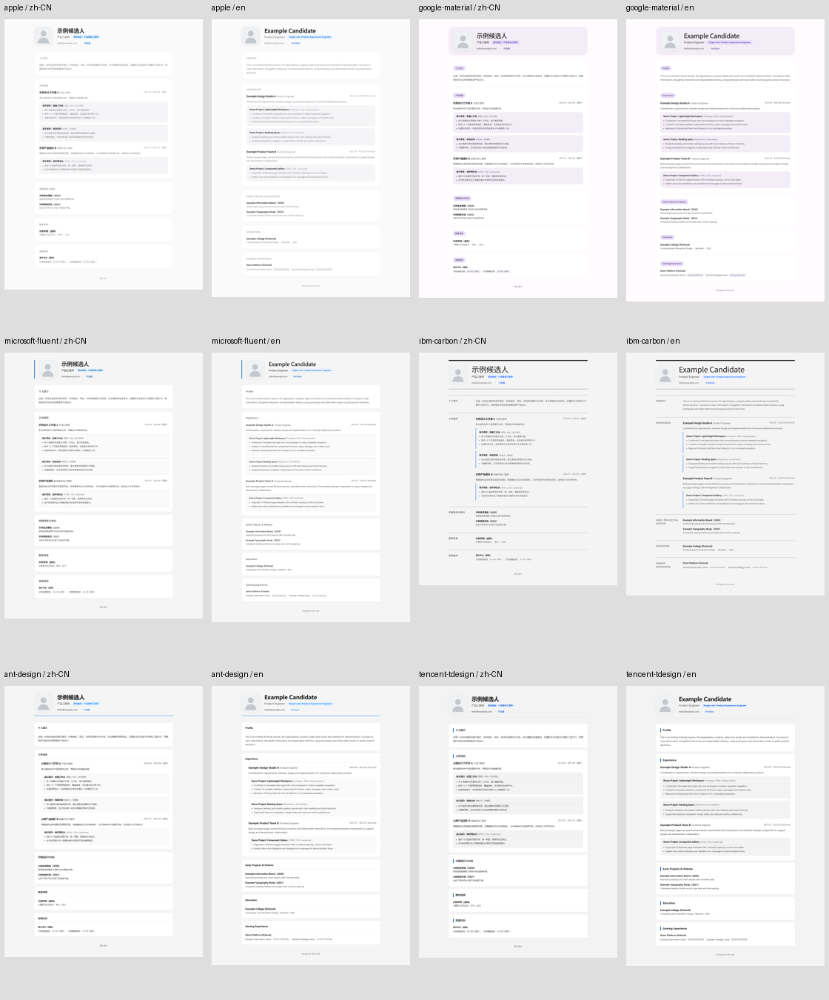
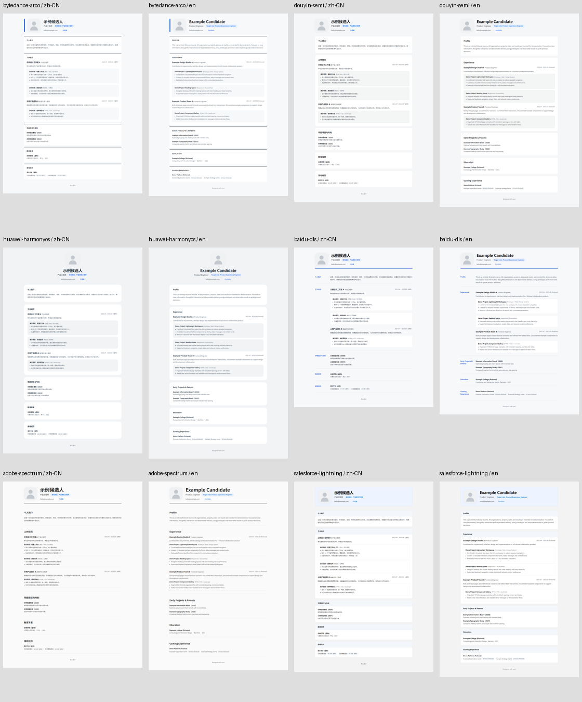

# Brand Style Resume

Create responsive HTML and A4 PDF resumes from Markdown or PDF using 12 company-inspired design systems. Supports Chinese and English labels, extra sections and an optional portrait. These are independent adaptations, not official company templates or a promise of better hiring outcomes.

[简体中文](README.md) · **English**

## Style gallery

[Open the local gallery](examples/preview/index.html). GitHub shows HTML source: download the repository and open the file in a browser. Every style uses the same fictional resume for comparison. All people, organizations, schools, dates and achievements are invented; the avatar is an original geometric placeholder.




| Style / design reference | Chinese web / PDF | English web / PDF |
| --- | --- | --- |
| [Apple](references/styles/apple/DESIGN.md) `apple` | [HTML](examples/preview/styles/apple/zh-CN/index.html) · [PDF](examples/preview/styles/apple/zh-CN/resume.pdf) | [HTML](examples/preview/styles/apple/en/index.html) · [PDF](examples/preview/styles/apple/en/resume.pdf) |
| [Google / Material 3](references/styles/google-material/DESIGN.md) `google-material` | [HTML](examples/preview/styles/google-material/zh-CN/index.html) · [PDF](examples/preview/styles/google-material/zh-CN/resume.pdf) | [HTML](examples/preview/styles/google-material/en/index.html) · [PDF](examples/preview/styles/google-material/en/resume.pdf) |
| [Microsoft / Fluent 2](references/styles/microsoft-fluent/DESIGN.md) `microsoft-fluent` | [HTML](examples/preview/styles/microsoft-fluent/zh-CN/index.html) · [PDF](examples/preview/styles/microsoft-fluent/zh-CN/resume.pdf) | [HTML](examples/preview/styles/microsoft-fluent/en/index.html) · [PDF](examples/preview/styles/microsoft-fluent/en/resume.pdf) |
| [IBM / Carbon](references/styles/ibm-carbon/DESIGN.md) `ibm-carbon` | [HTML](examples/preview/styles/ibm-carbon/zh-CN/index.html) · [PDF](examples/preview/styles/ibm-carbon/zh-CN/resume.pdf) | [HTML](examples/preview/styles/ibm-carbon/en/index.html) · [PDF](examples/preview/styles/ibm-carbon/en/resume.pdf) |
| [Ant Group / Ant Design](references/styles/ant-design/DESIGN.md) `ant-design` | [HTML](examples/preview/styles/ant-design/zh-CN/index.html) · [PDF](examples/preview/styles/ant-design/zh-CN/resume.pdf) | [HTML](examples/preview/styles/ant-design/en/index.html) · [PDF](examples/preview/styles/ant-design/en/resume.pdf) |
| [Tencent / TDesign](references/styles/tencent-tdesign/DESIGN.md) `tencent-tdesign` | [HTML](examples/preview/styles/tencent-tdesign/zh-CN/index.html) · [PDF](examples/preview/styles/tencent-tdesign/zh-CN/resume.pdf) | [HTML](examples/preview/styles/tencent-tdesign/en/index.html) · [PDF](examples/preview/styles/tencent-tdesign/en/resume.pdf) |
| [ByteDance / Arco](references/styles/bytedance-arco/DESIGN.md) `bytedance-arco` | [HTML](examples/preview/styles/bytedance-arco/zh-CN/index.html) · [PDF](examples/preview/styles/bytedance-arco/zh-CN/resume.pdf) | [HTML](examples/preview/styles/bytedance-arco/en/index.html) · [PDF](examples/preview/styles/bytedance-arco/en/resume.pdf) |
| [Douyin / Semi](references/styles/douyin-semi/DESIGN.md) `douyin-semi` | [HTML](examples/preview/styles/douyin-semi/zh-CN/index.html) · [PDF](examples/preview/styles/douyin-semi/zh-CN/resume.pdf) | [HTML](examples/preview/styles/douyin-semi/en/index.html) · [PDF](examples/preview/styles/douyin-semi/en/resume.pdf) |
| [Huawei / HarmonyOS](references/styles/huawei-harmonyos/DESIGN.md) `huawei-harmonyos` | [HTML](examples/preview/styles/huawei-harmonyos/zh-CN/index.html) · [PDF](examples/preview/styles/huawei-harmonyos/zh-CN/resume.pdf) | [HTML](examples/preview/styles/huawei-harmonyos/en/index.html) · [PDF](examples/preview/styles/huawei-harmonyos/en/resume.pdf) |
| [Baidu / Light DLS](references/styles/baidu-dls/DESIGN.md) `baidu-dls` | [HTML](examples/preview/styles/baidu-dls/zh-CN/index.html) · [PDF](examples/preview/styles/baidu-dls/zh-CN/resume.pdf) | [HTML](examples/preview/styles/baidu-dls/en/index.html) · [PDF](examples/preview/styles/baidu-dls/en/resume.pdf) |
| [Adobe / Spectrum](references/styles/adobe-spectrum/DESIGN.md) `adobe-spectrum` | [HTML](examples/preview/styles/adobe-spectrum/zh-CN/index.html) · [PDF](examples/preview/styles/adobe-spectrum/zh-CN/resume.pdf) | [HTML](examples/preview/styles/adobe-spectrum/en/index.html) · [PDF](examples/preview/styles/adobe-spectrum/en/resume.pdf) |
| [Salesforce / Lightning](references/styles/salesforce-lightning/DESIGN.md) `salesforce-lightning` | [HTML](examples/preview/styles/salesforce-lightning/zh-CN/index.html) · [PDF](examples/preview/styles/salesforce-lightning/zh-CN/resume.pdf) | [HTML](examples/preview/styles/salesforce-lightning/en/index.html) · [PDF](examples/preview/styles/salesforce-lightning/en/resume.pdf) |

Full desktop/mobile screenshots and every rendered PDF page live beside each preview. [Geometry results](docs/preview-checks.json) cover 24 style/language pairs and six career previews. [DESIGN.md](DESIGN.md) links to each adaptation's official sources, retrieval date, tokens, hierarchy and print rules. It also records existing community DESIGN.md discovery without copying third-party specifications.

## Install and migrate

Requires Node.js 22.20+ and npm. Install with [Vercel Skills CLI](https://github.com/vercel-labs/skills); the repository URL remains unchanged:

```bash
npx skills add Cliccker/apple-style-resume --skill brand-style-resume -a codex -y
npx skills add Cliccker/apple-style-resume --skill brand-style-resume -a codex -g -y
npx skills add Cliccker/apple-style-resume --list
```

The skill is now `brand-style-resume`; replace `$apple-style-resume` invocations accordingly. Existing CLI commands continue to work. For manual installs, back up and replace the old skill folder instead of keeping duplicate skills.

Alternatively clone the complete repository into `.agents/skills/brand-style-resume` in your project. Keep SKILL.md, assets, scripts, references and DESIGN.md together. Installing the skill does not install Python, fonts or optional dependencies.

## Use the skill

```text
$brand-style-resume Use resume.md and portrait.png to create an English IBM Carbon-inspired resume in output/resume, including a PDF.
```

```text
$brand-style-resume Restyle resume.pdf using Tencent TDesign. Preserve the source language, omit the photo, and export HTML and PDF to output/resume.
```

If no style is given, the skill shows choices and asks. Without a portrait, it asks whether to upload one or continue with a text-only header. It does not generate an avatar. Translation, uploads and deployment happen only when requested.

## CLI generation

Requires Python 3.10+. HTML generation uses only the standard library. Direct CLI usage is noninteractive and defaults to Apple, Chinese labels and no portrait.

```bash
python scripts/md_to_resume.py --list-styles
python scripts/md_to_resume.py resume.md output/resume --style ant-design
python scripts/md_to_resume.py resume.md output/resume --style ibm-carbon --lang en --photo portrait.png
# Original three-positional-argument usage remains supported.
python scripts/md_to_resume.py resume.md portrait.png output/resume
```

Outputs: index.html, resume_a4.html, source.md, and a photo copy when supplied, retaining JPG/JPEG/PNG format. CSS is embedded; outputs do not depend on the installed skill folder. --lang changes interface labels, not source content.

```bash
python -m pip install -r requirements-pdf.txt
python -m playwright install chromium
python scripts/export_pdf.py output/resume/resume_a4.html --output output/resume/resume.pdf
```

On Linux, use Playwright's `install --with-deps chromium` if browser OS dependencies are missing. Alternatively print the A4 HTML with CSS margins, background graphics enabled and browser headers/footers disabled. Content flows without truncation or forced page counts. Apple retains its employer page breaks; other styles flow continuously.

## PDF input: extract, visually review, normalize

```bash
python -m pip install -r requirements-input.txt
python scripts/prepare_pdf.py resume.pdf --output output/pdf-input
```

This creates per-page text, PNG previews and manifest.json. It is not OCR or a semantic layout parser. The skill reviews every page and prepares editable Markdown before rendering. Recover column order and use the current agent's visual/OCR capability for scanned and mixed pages. A valid text layer does not imply that image text was captured.

Ask about unresolved names, dates, numbers or other facts. If visual/OCR capabilities are unavailable, explain the affected pages and request a readable source. The CLI alone cannot recognize scanned text. See the [PDF workflow](references/pdf-input.md) and [four fictional PDF inputs with expected Markdown](examples/pdf-input).

## Markdown, fonts and samples

See [Markdown guidance](references/markdown-parsing.md). Summary, employment, education, skills, independent projects, certificates, awards, publications and unfamiliar headings are retained. Repeated sections keep their order. Complex HTML/tables/nested Markdown should be normalized in a working copy; source HTML is escaped rather than executed.

Fonts load locally by default. Missing brand fonts use each documented fallback and can change line wrapping and pagination. Apple retains [Inter](https://rsms.me/inter/) and [Noto Sans SC](https://fonts.google.com/specimen/Noto+Sans+SC), Carbon uses IBM Plex Sans, and Material uses Roboto. See each style's DESIGN.md for full stacks. --web-fonts opts into that style's open online font families; wait for fonts and photos before export. No proprietary font binaries or company marks are distributed.

[12 new Markdown profiles](examples/profiles) cover six fictional candidates in two languages. [Career previews](examples/preview/careers) cover graduate, frontend, backend, product, design and data roles, including long content, long links, no employment and additional sections. [Six primary source studies](references/sample-sources.md) informed structure only; actual candidate data was not copied. Real input/output is not automatically anonymized.

## Development and validation

```bash
python -m unittest discover -s tests -v
python -m pip install -r requirements-dev.txt
python -m playwright install chromium
python scripts/build_pdf_fixtures.py
python scripts/build_previews.py
```

PDF input tests skip without optional dependencies. Install requirements-input.txt to run them. The eight original tests remain; additions cover cross-style content, extra sections, no-photo behavior, safe links, mixed PDF content and CLI compatibility. See the [validation record](docs/validation.md) for visual and recognition checks.
