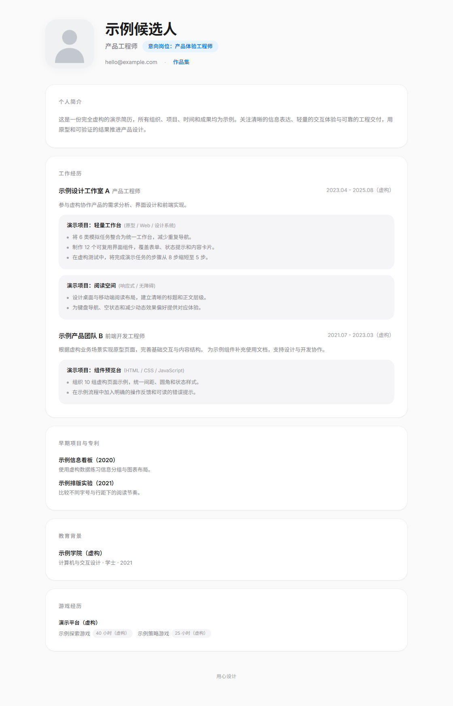
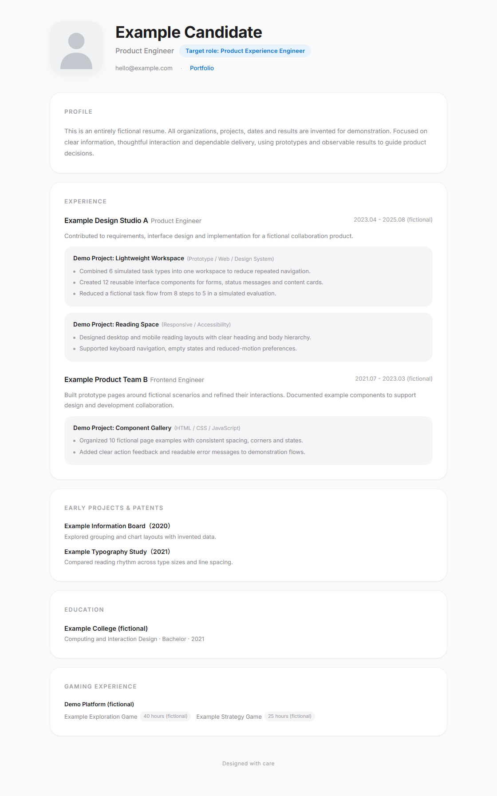
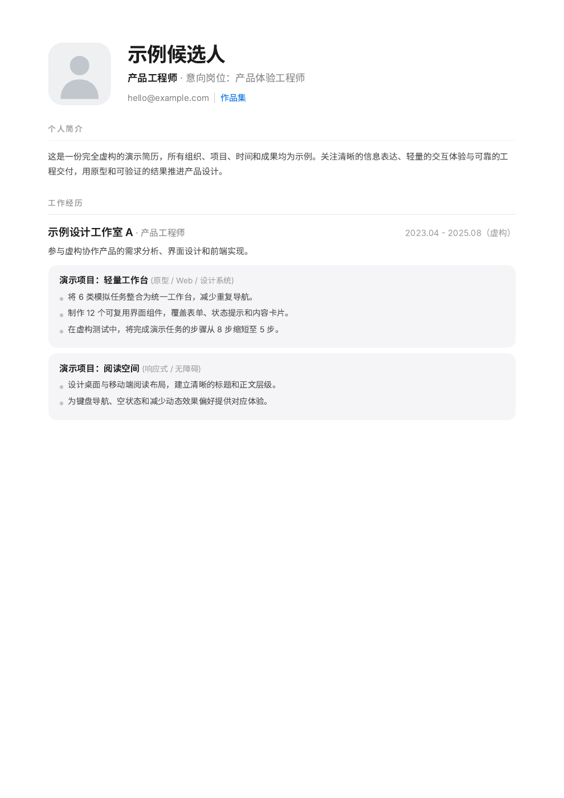

# Apple Style Resume

将 Markdown 简历和照片生成 Apple 风格的静态网页与 A4 PDF。保留克制的灰白配色、圆角卡片、清晰层级，以及 **Inter / Noto Sans SC** 字体组合。

**简体中文** · [English](README.en.md)

## 效果预览

以下内容完全虚构：姓名、组织、学校、项目、时间和成果均为演示数据；头像是原创几何占位图，不含真实照片、电话或个人链接。网页和 PDF 均由本仓库脚本实际生成。

| 中文桌面网页 | English desktop |
| --- | --- |
|  |  |

| 移动端 | A4 PDF（第 1 页） |
| --- | --- |
|  |  |

可下载完整的 [中文 PDF](examples/preview/zh-CN/resume.pdf)、[English PDF](examples/preview/en/resume.pdf)，或查看 [中文网页源码](examples/preview/zh-CN/index.html) / [English HTML](examples/preview/en/index.html)。GitHub 展示 HTML 源码，下载后用浏览器打开即可预览。

## 安装技能：推荐使用 npx

需要 Node.js **22.20 或更高版本**及 npm。安装器使用开源的 [Vercel Skills CLI](https://github.com/vercel-labs/skills)，不需要单独发布或安装本项目的 npm 包。

```bash
# 交互式选择目标 Agent，默认安装到当前项目
npx skills add Cliccker/apple-style-resume

# 为当前项目的 Codex 安装，跳过交互选择
npx skills add Cliccker/apple-style-resume --skill apple-style-resume -a codex -y

# 安装到用户范围，供多个项目使用
npx skills add Cliccker/apple-style-resume --skill apple-style-resume -a codex -g -y
```

仅查看可发现的技能：

```bash
npx skills add Cliccker/apple-style-resume --list
npx skills list -a codex
```

默认使用 Codex；也可以在安装器中选择其他支持技能的 Agent。生成脚本与 Python 的使用方式相同，但本项目的技能调用验证以 Codex 为目标。

### ZIP / 手动安装

从 [Release](https://github.com/Cliccker/apple-style-resume/releases/latest) 下载 ZIP。解压后的 `apple-style-resume` 文件夹应直接包含 `SKILL.md`、`assets`、`scripts` 等文件。将整个文件夹放入项目的 `.agents/skills/`，或用户目录下的 `.agents/skills/`。已存在同名技能时，请先保留旧版本，再选择替换，避免安装重复副本。

也可以手动克隆到项目中。以下命令从目标项目根目录运行。

Windows PowerShell：

```powershell
New-Item -ItemType Directory -Force .agents/skills | Out-Null
git clone https://github.com/Cliccker/apple-style-resume.git .agents/skills/apple-style-resume
```

macOS / Linux：

```bash
mkdir -p .agents/skills
git clone https://github.com/Cliccker/apple-style-resume.git .agents/skills/apple-style-resume
```

Codex 会发现标准技能目录；若未出现，重启后再查看。安装位置依据 [OpenAI 官方技能文档](https://learn.chatgpt.com/docs/build-skills)。

## 在 Codex 中使用

安装后，提供你自己的 Markdown 简历、JPG/PNG 照片以及输出目录，例如：

```text
$apple-style-resume 请用 resume.md 和 portrait.png 生成中文 Apple 风格简历，输出到 output/resume。保留 Inter 和 Noto Sans SC 字体，并导出 PDF。
```

```text
$apple-style-resume Use resume.md and portrait.png to create an English resume in output/resume and export an A4 PDF. Use the original Inter and Noto Sans SC typography.
```

技能安装不会自动安装 Python、字体或 PDF 依赖，按下面的步骤准备即可。

## 字体：保持原有设计效果

**字体是设计的一部分。推荐先安装 [Inter](https://rsms.me/inter/) 和 [Noto Sans SC](https://fonts.google.com/specimen/Noto+Sans+SC)**，包括 400、500、600、700 字重；可变字体也可以。前者用于拉丁字符，后者用于简体中文。这两款是本模板的字体选择，并非 Apple 官方字体。

- Windows：解压字体后右键安装；macOS：使用“字体册”；Linux：放入用户字体目录并执行 `fc-cache -f`。安装后重新打开浏览器或 PDF 导出进程。
- 默认优先使用本地安装的两款字体，支持离线生成，不附带字体文件。
- 若不方便安装，生成时加 `--web-fonts`，通过 Google Fonts 在线加载这两款字体。截图示例使用此方式；预览和导出时需要能够访问 Google Fonts。
- 字体不可用时回退到系统字体，字形、换行和 PDF 页数可能变化。出现回退时应先补齐字体，再调整排版。

## 命令行快速使用

需要 **Python 3.10+**。HTML 生成只使用标准库，无需安装 Python 第三方依赖。以下从独立克隆的仓库根目录运行：

```bash
git clone https://github.com/Cliccker/apple-style-resume.git
cd apple-style-resume

# 中文界面，正文保持源文件语言
python scripts/md_to_resume.py examples/resume.zh-CN.md examples/avatar.png output/zh-CN --lang zh-CN

# 英文界面，按需启用在线原版字体
python scripts/md_to_resume.py examples/resume.en.md examples/avatar.png output/en --lang en --web-fonts
```

替换输入路径即可使用自己的文件。原有三个位置参数仍有效，默认中文；带空格的路径请使用引号。`--lang` 只切换标题、页脚及 HTML 语言，不翻译正文。

输出目录包含：

| 文件 | 用途 |
| --- | --- |
| `index.html` | 响应式静态网页 |
| `resume_a4.html` | A4 打印版 HTML |
| `photo.jpg` / `photo.jpeg` / `photo.png` | 保留格式的照片副本 |
| `resume.pdf` | 执行下面的导出命令后生成 |

用浏览器打开 HTML 即可查看。没有内容的章节自动隐藏。不同工作单位在 PDF 中另起一页，长内容自然分页，不强制限制页数。

### 导出 PDF

```bash
python -m pip install -r requirements-pdf.txt
python -m playwright install chromium
python scripts/export_pdf.py output/zh-CN/resume_a4.html --output output/zh-CN/resume.pdf
python scripts/export_pdf.py output/en/resume_a4.html --output output/en/resume.pdf
```

Linux 若缺少浏览器系统依赖，可执行 `python -m playwright install --with-deps chromium`。也可直接打开 `resume_a4.html`，使用浏览器“打印 → 另存为 PDF”：选择 A4、启用背景图形、关闭浏览器页眉页脚，保留模板的打印边距。导出前确认字体和照片加载完成，并检查每一页。

## Markdown 输入格式

参照 [中文完整示例](examples/resume.zh-CN.md)、[English example](examples/resume.en.md) 和 [解析说明](references/markdown-parsing.md)。

- `# 姓名`，随后是职位、可选的意向职位和联系方式。
- `## 个人简介`、`## 工作经历`、`## 早期项目`、`## 教育背景`、`## 游戏经历`，均支持对应英文标题。
- `### 公司 | 职位`，下一行使用斜体日期；项目用独立加粗标题，成果用列表。
- 教育条目使用 `- **学校** | 专业 | 学位 | 年份`。

这是结构化简历格式，不是通用 Markdown 排版器；不支持任意 HTML、表格和复杂内联格式。实际生成会保留你提供的个人信息，不会自动脱敏或上传。

## Apple 设计风格来源

| 官方参考 | 本项目的借鉴方式 |
| --- | --- |
| [Human Interface Guidelines — Typography](https://developer.apple.com/design/human-interface-guidelines/typography) | 用字号、字重和文本层级组织内容 |
| [Human Interface Guidelines — Layout](https://developer.apple.com/design/human-interface-guidelines/layout) | 建立稳定的对齐、留白和信息分组 |
| [Human Interface Guidelines — Color](https://developer.apple.com/design/human-interface-guidelines/color) | 使用克制的颜色区分内容与交互 |
| [Apple Mac 产品页面](https://www.apple.com/mac/) | 观察简洁排版、卡片和大面积留白的视觉表达 |

具体色值、字体组合、圆角和阴影是本项目的设计选择，详见 [DESIGN.md](DESIGN.md)，不是 Apple 规定的简历规范。本项目独立开发，与 Apple 无隶属关系，不包含 Apple 标志、专有字体或官网截图。

## 开发验证

```bash
python -m unittest discover -s tests -v
```

公开示例均为从零创建的虚构内容，发布包不包含真实简历、照片、旧 Git 历史或开发机资料。GitHub 账号和仓库标识作为发布所需信息保留。
